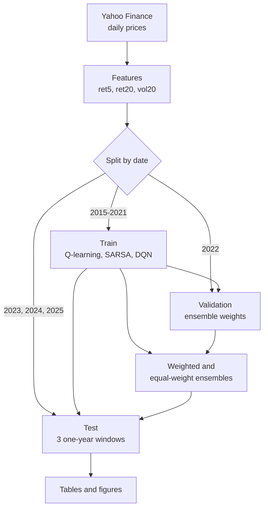

# 6650-Final

**Comparative Study of Shallow and Deep Reinforcement Learning Algorithms in Stock Trading with Performance-Based Weighted Ensemble**

DSAN 6650 (Reinforcement Learning), Final Project. Presentation on **December 2**.

[](https://github.com/TarynDeng/6650-Final/actions/workflows/tests.yml)

We train three RL algorithms (Q-learning, SARSA, DQN) to trade a single stock on historical daily data. Each algorithm decides when to buy, when to sell, how much, and when to hold. We then compare the trained algorithms, two ensembles of them, and buy-and-hold on years the agents never saw. Everything is a simulation with historical prices and simulated cash; there is no real trading.

| | |
|---|---|
| **Status** | The full pipeline works: data, environment, all three algorithms, both ensembles, evaluation, tables and figures. 39 tests run automatically on pushes to `main` and on every pull request. |
| **Still to do** | Team review of the [placeholder decisions](#8-decisions-and-their-status), slides, paper |
| **Full proposal** | [`docs/proposal.md`](docs/proposal.md) (all equations and design rules) |
| **Slide outline** | [`docs/presentation.md`](docs/presentation.md) |
| **Paper (LaTeX)** | [`paper/main.tex`](paper/main.tex) |

## Contents

1. [Quick start](#1-quick-start)
2. [Research questions](#2-research-questions)
3. [How the experiment works](#3-how-the-experiment-works)
4. [Latest results](#4-latest-results)
5. [Repository layout](#5-repository-layout)
6. [Running variants](#6-running-variants)
7. [Output files](#7-output-files)
8. [Decisions and their status](#8-decisions-and-their-status)
9. [Known limitations](#9-known-limitations)
10. [How to contribute](#10-how-to-contribute)
11. [Deliverables and timeline](#11-deliverables-and-timeline)

---

## 1. Quick start

Requires **Python 3.12** (the pinned package versions need it). Everything runs on a laptop CPU; no GPU is needed.

**1. Install**

```bash
git clone https://github.com/TarynDeng/6650-Final.git
cd 6650-Final
python -m venv .venv
source .venv/bin/activate          # Windows: .venv\Scripts\activate
pip install -r requirements.txt
```

**2. Check that everything works** (a few seconds)

```bash
python -m pytest -q tests
```

**3. Run one stock with one seed** (about 1 minute)

```bash
python experiments/run_experiments.py --phase 1 --tickers AAPL --seeds 0
```

The price data for the three default stocks is already in the repository (`data/raw/`), so no download is needed and everyone gets exactly the same numbers. A stock that is not there yet is downloaded from Yahoo Finance on first use.

**4. Run the full experiment** (about 15 minutes: 3 stocks × 5 seeds × 3 algorithms)

```bash
python experiments/run_experiments.py --phase 1   # train Q-learning, SARSA, DQN; evaluate them and buy-and-hold
python experiments/run_experiments.py --phase 2   # build and evaluate the two ensembles
python experiments/run_experiments.py --phase 3   # final tables and figures for all six methods
```

The results land in `results/`. Start with `results/tables/phase3_summary_by_method.csv` and the `results/figures/phase3_*.png` plots (see [Output files](#7-output-files)).

---

## 2. Research questions

| RQ | Question | Where the answer comes from |
|----|----------|-----------------------------|
| **RQ1** Performance | How does shallow (tabular) RL compare with deep RL in trading performance? | `phase3_summary_by_method.csv`, `phase3_terminal_return.png` |
| **RQ2** Terminal losses | How often, and how badly, does each method end a test year with a loss? | Loss categories in the summary tables, `phase3_loss_categories.png` |
| **RQ3** Learning and stability | How fast do they learn, and how much do results vary across random seeds? | `phase3_learning_curves.png`, `phase3_seed_stability.csv` |
| **RQ4** Ensemble | Does a vote weighted by validation performance beat the single algorithms and an equal-weight vote? | `weighted_ens` vs. `equal_ens` rows in the summary tables |

---

## 3. How the experiment works



Each step is described below. Every number here is a default in [`src/config.py`](src/config.py), so it can be changed in one place.

### Data

| Item | Setting |
|---|---|
| Source | Yahoo Finance via `yfinance`, split- and dividend-adjusted daily prices, downloaded on 2026-11-26 and committed in `data/raw/` with SHA-256 checksums |
| Stocks | AAPL (technology), JPM (banking), XOM (energy) |
| Training | 2015-01-01 to 2021-12-31 (about 1,760 trading days per stock) |
| Validation | 2022 (one year) |
| Test | 2023, 2024 and 2025, each evaluated as a separate one-year window |

The test years are never used for training, tuning, or ensemble weights.

Why the price files are committed: Yahoo Finance re-adjusts historical prices every time a stock pays a new dividend, so downloading the same dates later gives slightly different numbers. The code checks every file against `data/raw/SHA256SUMS` and also rejects data with missing or non-positive prices, gaps longer than a week, or dates that do not cover the experiment.

### Trading environment ([`src/environment.py`](src/environment.py))

One episode trades one stock, starting with $10,000 in cash.

- **Observation:** 5-day log return, 20-day log return, 20-day volatility, and the share of the portfolio currently held in stock. All of these use prices up to and including today only.
- **Timing:** the agent sees today's data, its order fills at today's closing price, and the portfolio is valued at tomorrow's close. No information from the future is used.
- **Rules:** no borrowing (leverage), no short selling, 0.1% fee on every trade, fractional shares allowed. Trades worth less than one cent are skipped.
- **Actions:** 9 choices that set both the direction and the size of a trade.

| Action | Meaning | Action | Meaning |
|:-:|---|:-:|---|
| 0 | Hold (do nothing) | | |
| 1 | Buy with 25% of available cash | 5 | Sell 25% of shares held |
| 2 | Buy with 50% of available cash | 6 | Sell 50% of shares held |
| 3 | Buy with 75% of available cash | 7 | Sell 75% of shares held |
| 4 | Buy with 100% of available cash | 8 | Sell 100% of shares held |

- **Reward:** the daily log return of the portfolio value, fees included:

  $$r_t = \ln\frac{V_{t+1}}{V_t}$$

  where $V_t$ is cash plus the market value of the shares. Over an episode the rewards add up to $\ln(V_T/V_0)$, so maximizing total reward means maximizing final wealth. There is no extra risk penalty.

The tests in [`tests/test_environment.py`](tests/test_environment.py) check the accounting: fees, buy-sell round trips, partial orders, and that the rewards add up exactly.

### Agents

| Algorithm | Type | What it sees | Key settings | Code |
|---|---|---|---|---|
| Q-learning | Tabular, off-policy | 135 discrete states: each market feature cut into 3 bins (learned from training data) × 5 position levels | step size 0.05 | [`src/tabular_rl.py`](src/tabular_rl.py) |
| SARSA | Tabular, on-policy | Same 135 states | step size 0.05 | [`src/tabular_rl.py`](src/tabular_rl.py) |
| DQN | Neural network, off-policy | The 4 continuous features, standardized with training-data statistics | 2 hidden layers of 64, replay buffer, target network, based on our HW-2 code | [`src/deep_rl.py`](src/deep_rl.py) |

### Training ([`src/training.py`](src/training.py))

All three algorithms share one training loop, so the comparison is fair:

- the same budget of **100,000 environment steps** (trading days) per run;
- episodes are random **252-day (one-year) windows** inside 2015-2021;
- exploration starts fully random and decays linearly to 5% over the first half of training;
- the same discount factor, **γ = 0.99**;
- **5 random seeds** per algorithm and stock;
- every algorithm is evaluated with its **final** model. The 2022 return is recorded every 5,000 steps to draw learning curves, but it is never used to pick a model.

### Ensembles ([`src/ensemble.py`](src/ensemble.py))

For each stock and seed, the three trained agents vote on every trading day.

- **Weighted ensemble:** each agent's weight comes from its terminal return $\bar R_i$ on the 2022 validation year:

  $$w_i = \frac{\exp(\bar R_i/\tau)}{\sum_j \exp(\bar R_j/\tau)}, \qquad \tau = 0.05$$

  The action with the largest total weight wins:

  $$a_t = \arg\max_a \sum_i w_i\,\mathbf{1}[\pi_i(s_t) = a]$$

- **Equal-weight ensemble:** the same vote with $w_i = 1/3$. This is the control.
- **Ties:** take the action of the single highest-weight agent; if the weights are equal, take Hold if it is tied, otherwise the lowest action number. The rule was fixed before looking at any results.
- **Same account:** every agent decides from the ensemble's own cash and position, not from its own separate backtest.

### Evaluation ([`src/evaluation.py`](src/evaluation.py))

Every method trades each test year once with exploration off. Buy-and-hold buys with all the cash on the first day, pays the same fee, and holds to the end.

| Metric | Definition |
|---|---|
| Terminal return | $R_T = (V_T - V_0)/V_0$ at the end of a test year |
| Terminal loss category | 1: profit or break-even; 2: loss up to 20%; 3: loss 20-40%; 4: loss over 40%. This is the loss at the **end** of the year, **not** the maximum drawdown. |
| Stability | Standard deviation across seeds, stocks and test years |
| Trading behavior | How often each action is chosen, number of trades, total fees |

---

## 4. Latest results

The final run with the current settings is in progress; this section will be updated with its numbers. To reproduce it, run the three commands in [Quick start, step 4](#1-quick-start).

---

## 5. Repository layout

```
6650-Final/
├── README.md                   # this file
├── requirements.txt            # Python dependencies
├── src/                        # all project code
│   ├── config.py               #   every setting and its default (start here to change a decision)
│   ├── environment.py          #   data download, features, date split, trading environment
│   ├── tabular_rl.py           #   state discretizer, Q-learning, SARSA
│   ├── deep_rl.py              #   DQN: network, replay buffer, agent
│   ├── training.py             #   the training loop shared by all algorithms
│   ├── ensemble.py             #   softmax weights, weighted vote, tie-break
│   └── evaluation.py           #   metrics, buy-and-hold, tables, plots
├── experiments/
│   └── run_experiments.py      # command-line entry point (phases 1-3)
├── tests/                      # pytest: accounting, data, agents, determinism, ensemble, statistics
├── .github/workflows/tests.yml # runs the tests and a short smoke run on pushes to main and pull requests
├── data/raw/                   # daily prices for the default stocks + SHA256SUMS (in git)
├── results/                    # models, logs, tables, figures (not in git; see results/README.md)
├── docs/
│   ├── proposal.md             # full project proposal with equations
│   └── presentation.md         # slide-by-slide outline for December 2
└── paper/
    ├── main.tex                # paper skeleton (LaTeX, 4-6 pages)
    ├── references.bib
    └── figures/                # final figures for the paper (in git)
```

Build the paper with a TeX distribution that has `latexmk`:

```bash
cd paper && latexmk -pdf main.tex
```

---

## 6. Running variants

**Command-line options** (all optional except `--phase`):

| Option | Meaning | Default |
|---|---|---|
| `--phase {1,2,3}` | 1: train and evaluate the algorithms; 2: ensembles; 3: final tables and figures | required |
| `--tickers AAPL JPM` | Stocks to use | the three in `src/config.py` |
| `--seeds 0 1 2` | Random seeds | 0-4 |
| `--algos qlearning dqn` | Algorithms to train in phase 1 (phases 2 and 3 need all three) | all three |
| `--steps 20000` | Training steps per run | 100,000 |
| `--results-dir PATH` | Where outputs go | `results/` |

Phases 2 and 3 automatically use the stocks and seeds of the last phase 1 run. They stop with an error if `src/config.py` or the files in `data/raw/` changed since then.

**Changing a design decision** (fee, stocks, dates, number of bins, network size, γ, τ, ...): edit the matching field in [`src/config.py`](src/config.py), then re-run all three phases. Each field has a comment that explains it.

---

## 7. Output files

Everything goes under `results/`. Runs are named `{algorithm}_{TICKER}_seed{n}`, for example `dqn_AAPL_seed0`.

| Path | Contents |
|---|---|
| `tables/phase3_summary_by_method.csv` | **Main result**, one row per method (columns explained below) |
| `tables/phase3_paired_comparisons.csv` | Method A vs. method B, stock-year by stock-year: mean difference, how many stock-years A wins, and two 95% bootstrap intervals (see below) |
| `tables/phase3_summary_by_ticker.csv`, `..._by_window.csv` | The same summary split by stock or by test year |
| `tables/phase3_seed_stability.csv` | Spread of results across seeds |
| `tables/phase3_trading_behavior.csv` | Action frequencies, trade counts, fees |
| `tables/phase{1,2}_{val,test}.csv` | One row per method, stock, seed and year (the raw results) |
| `tables/phase2_weights.csv` | Ensemble weights and the validation returns they came from |
| `figures/phase3_terminal_return.png` | Mean test return per method and stock |
| `figures/phase3_loss_categories.png` | Share of test episodes (stock-years × seeds) in each loss category |
| `figures/phase3_learning_curves.png` | Validation return during training, one panel per stock |
| `figures/phase3_action_frequencies.png` | Which actions each method uses |
| `figures/phase3_values_{TICKER}_{year}.png` | Portfolio value over a test year, all methods (seed 0) |
| `logs/{run}.csv` | Learning curve of one run |
| `models/{run}.pkl` / `.pt` | Trained Q-table / DQN weights |
| `run_manifest.json` | What the last run used: stocks, seeds, all settings, git commit, package versions, data checksums |

**How the summary tables count.** One stock in one test year (a "stock-year") is one market sample: 3 stocks × 3 years = 9. The 5 seeds of an algorithm are averaged within each stock-year first, because they repeat the same market and only measure training randomness. So `mean`, `median` and `std_windows` are over the 9 stock-years, `seed_std` is the typical spread between seeds, `n_episodes` counts every evaluated year (stock-years × seeds), and `share_cat1` to `share_cat4` give the share of those episodes in each loss category.

**The two confidence intervals in the paired comparisons.** `ci_low`/`ci_high` resample the 9 stock-years as if they were independent. They are too narrow, because stocks in the same year share the market's move. `ci_year_low`/`ci_year_high` resample whole years, which respects that, but with only 3 years the result is very coarse. Treat both as rough indications.

**Every phase uses the same run.** Phase 1 first checks all the price data, then deletes the previous run's `models/`, `logs/`, `tables/`, `figures/` and `run_manifest.json`, and writes a new manifest when it finishes. It refuses to clear a folder that contains anything else. Phases 2 and 3 read the manifest and stop with an error if the stocks, seeds, `src/config.py` or the price files no longer match.

---

## 8. Decisions and their status

The code needed a value for every open question, so each one has a **placeholder default**. Nothing below is final until the team agrees. To change one, edit [`src/config.py`](src/config.py) and update this table.

| Decision | Current default | Status |
|---|---|---|
| Data source and price type | yfinance, adjusted prices | Needs team confirmation |
| Stocks | AAPL, JPM, XOM | Needs team confirmation; more stocks would make the results more reliable (see [limitations](#9-known-limitations)) |
| Dates | Train 2015-2021, validation 2022, test 2023-2025 | From the proposal |
| Trading environment | Small custom Gymnasium environment, tested | Proposed: Gym Trading Env uses target positions, not "buy x% of cash" orders |
| Execution price and fees | Fill at today's close; 0.1% per trade; fractional shares | Needs team confirmation |
| Actions | The 9 actions above | From the proposal |
| Tabular state | 3 bins per market feature × 5 position levels = 135 states | Needs team confirmation |
| DQN implementation | Our HW-2-style PyTorch DQN, 64-64 network | Needs team confirmation |
| Training budget | 100,000 steps per run, 5 seeds | Needs team confirmation |
| Discount factor | γ = 0.99 for all algorithms | Needs team confirmation |
| Model selection | Final model, no checkpoint picking on validation | Decided: using 2022 both to pick checkpoints and to set the weights biased the weighted ensemble toward DQN |
| Ensemble temperature | τ = 0.05 | Needs team confirmation |
| Tie-break rule | Top-weight agent, then Hold, then lowest action | Proposed, fixed before seeing results |
| Equations marked *reconstructed* in the proposal | As written in [`docs/proposal.md`](docs/proposal.md) | Needs confirmation by the outline's author |
| Paper template and slide software | Plain LaTeX `article` | Ask the instructor |
| Repository visibility | Public | The course asks for a **private** repository; only the owner can change it |
| Team roles | Not assigned | Open |

---

## 9. Known limitations

- **Small test sample.** 3 stocks × 3 years = 9 stock-years, and they are not independent: stocks in the same year share the market's move, so the effective sample is closer to 3 years. The 5 seeds measure training randomness, not more market data.
- **Mostly rising markets.** 2023-2025 was strong for these stocks, so buy-and-hold is hard to beat and large losses are rare, which leaves little data for RQ2.
- **Short validation period.** One year (2022) sets the ensemble weights.
- **Limited training data.** About 1,760 trading days per stock; 100,000 steps reuse the same history many times, which can lead to overfitting.
- **Simple market model.** No price impact or bid-ask spread; one stock at a time.

---

## 10. How to contribute

1. Pull the latest `main`, then create a branch: `git checkout -b your-name/short-topic`.
2. Make the change. If you change a design decision, edit `src/config.py` and the table in [Section 8](#8-decisions-and-their-status).
3. Run `python -m pytest -q tests` and make sure it passes (GitHub also runs it on your pull request).
4. Push the branch and open a pull request. Describe what changed and, for experiment changes, how the results moved.
5. Do not commit `results/`; it is git-ignored on purpose. If you add a stock, commit its `data/raw/{TICKER}.csv` and add its checksum: `cd data/raw && shasum -a 256 *.csv > SHA256SUMS`. Final figures for the paper go in `paper/figures/`.

---

## 11. Deliverables and timeline

| Deliverable | Where | Due |
|---|---|---|
| Reproducible code | this repository | with the paper |
| Presentation, 10-15 minutes | [`docs/presentation.md`](docs/presentation.md) (outline) | **December 2** |
| Research paper, 4-6 pages | [`paper/`](paper/) | to be confirmed |

| Date | Goal |
|---|---|
| Nov 26 | Full pipeline working (done) |
| Nov 27-29 | Team reviews the defaults; final experiment run; experiments frozen on Nov 29 |
| Nov 30 - Dec 1 | Slides and rehearsal |
| Dec 2 | Presentation |
| After Dec 2 | Paper |
