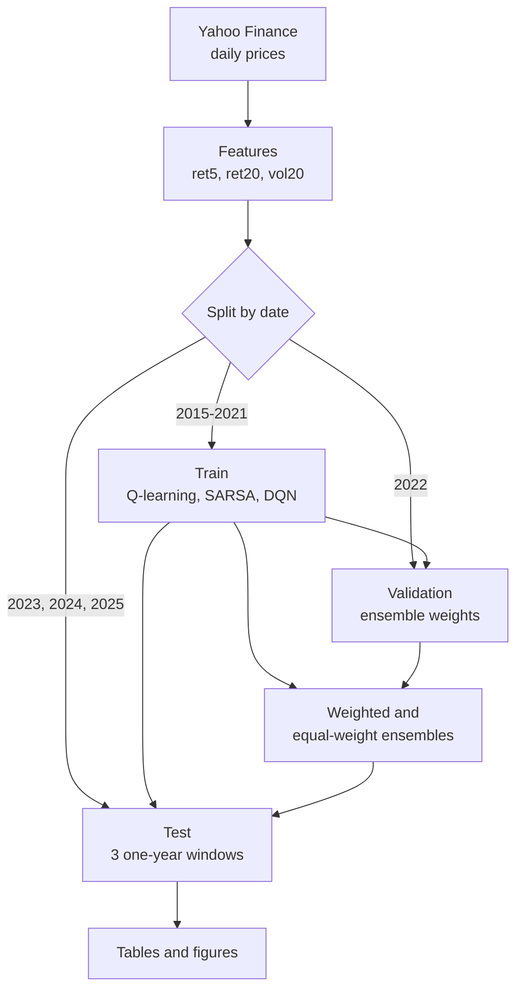

# 6650-Final

**Comparative Study of Shallow and Deep Reinforcement Learning Algorithms in Stock Trading with Performance-Based Weighted Ensemble**

DSAN 6650 (Reinforcement Learning), Final Project. Presentation on **December 2**.

[](https://github.com/TarynDeng/6650-Final/actions/workflows/tests.yml)

We train three RL algorithms (Q-learning, SARSA, DQN) to trade a single stock on historical daily data. Each algorithm decides when to buy, when to sell, how much, and when to hold. We then compare the trained algorithms, two ensembles of them, and buy-and-hold on years the agents never saw. Everything is a simulation with historical prices and simulated cash; there is no real trading.

| | |
|---|---|
| **Status** | The full pipeline works: data, environment, all three algorithms, both ensembles, evaluation, tables and figures. The tests, the linter and a short run of all three phases run automatically on pushes to `main` and on every pull request. |
| **Still to do** | Team review of the [placeholder decisions](#8-decisions-and-their-status), finishing the slides, writing the paper |
| **Full proposal** | [`docs/proposal.md`](docs/proposal.md) (the original plan, with notes on what was implemented) |
| **Slides (draft)** | [`slides/6650_final_presentation.pptx`](slides/6650_final_presentation.pptx), plan in [`docs/presentation.md`](docs/presentation.md) |
| **Paper (LaTeX)** | [`paper/main.tex`](paper/main.tex) |

## Contents

1. [Quick start](#1-quick-start)
2. [Research questions](#2-research-questions)
3. [How the experiment works](#3-how-the-experiment-works)
4. [Latest results](#4-latest-results)
5. [Repository layout](#5-repository-layout)
6. [Running variants](#6-running-variants)
7. [Output files](#7-output-files)
8. [Decisions and their status](#8-decisions-and-their-status)
9. [Known limitations](#9-known-limitations)
10. [How to contribute](#10-how-to-contribute)
11. [Deliverables and timeline](#11-deliverables-and-timeline)

---

## 1. Quick start

Requires **Python 3.12** (the pinned package versions need it). Everything runs on a laptop CPU; no GPU is needed.

**1. Install**

```bash
git clone https://github.com/TarynDeng/6650-Final.git
cd 6650-Final
python -m venv .venv
source .venv/bin/activate          # Windows: .venv\Scripts\activate
pip install torch==2.15.0 --index-url https://download.pytorch.org/whl/cpu   # CPU-only PyTorch (much smaller)
pip install -r requirements.txt
```

**2. Check that everything works** (about 10 seconds)

```bash
python -m pytest -q
```

**3. Try one stock with one seed** (about 1 minute). This writes to `results_quick/`, so it does not touch the committed results:

```bash
python experiments/run_experiments.py --phase 1 --tickers AAPL --seeds 0 --results-dir results_quick
```

The price data for the three default stocks is already in the repository (`data/raw/`), so no download is needed and everyone gets exactly the same numbers. A stock that is not there yet is downloaded from Yahoo Finance on first use.

**4. Reproduce the full experiment** (about 15 minutes: 3 stocks × 5 seeds × 3 algorithms). This replaces the results in `results/`:

```bash
python experiments/run_experiments.py --phase 1   # train Q-learning, SARSA, DQN; evaluate them and buy-and-hold
python experiments/run_experiments.py --phase 2   # build and evaluate the two ensembles
python experiments/run_experiments.py --phase 3   # final tables and figures for all six methods
```

The result tables of the reported run are committed. Start with `results/tables/phase3_summary_by_method.csv`; the figures appear in `results/figures/` once you run phase 3 (see [Output files](#7-output-files)).

---

## 2. Research questions

| RQ | Question | Where the answer comes from |
|----|----------|-----------------------------|
| **RQ1** Performance | How does shallow (tabular) RL compare with deep RL in trading performance? | `phase3_summary_by_method.csv`, `phase3_paired_comparisons.csv` |
| **RQ2** Terminal losses | How often, and how badly, does each method end a test year with a loss? | Loss-category shares in the summary tables, `phase3_loss_categories.png` |
| **RQ3** Learning and stability | How fast do they learn, and how much do results vary across random seeds? | `phase3_learning_curves.png`, `phase3_seed_stability.csv` |
| **RQ4** Ensemble | Does a vote weighted by validation performance beat the single agents and an equal-weight vote? | `weighted_ens` and `equal_ens` rows, `phase2_weights.csv` |

---

## 3. How the experiment works



Every number below is a default in [`src/config.py`](src/config.py), so it can be changed in one place.

### Data ([`src/data.py`](src/data.py))

| Item | Setting |
|---|---|
| Source | Yahoo Finance via `yfinance`, split- and dividend-adjusted daily prices, downloaded on 2026-11-26 and committed in `data/raw/` with SHA-256 checksums |
| Stocks | AAPL (technology), JPM (banking), XOM (energy) |
| Training | 2015-01-01 to 2021-12-31 (about 1,760 trading days per stock) |
| Validation | 2022 (one year) |
| Test | 2023, 2024 and 2025, each evaluated as a separate one-year window |

The test years are never used for training, tuning, or ensemble weights. The price files are committed because Yahoo Finance re-adjusts historical prices whenever a stock pays a new dividend, so downloading the same dates later gives slightly different numbers. The code checks every file against `data/raw/SHA256SUMS`, sorts the rows by date, and rejects missing or non-positive prices, duplicate dates, gaps longer than a week, and date ranges that do not cover the experiment.

### Trading environment ([`src/environment.py`](src/environment.py))

One episode trades one stock, starting with $10,000 in cash.

- **Observation:** 5-day log return, 20-day log return, 20-day volatility, and the share of the portfolio held in stock. All use prices up to and including today only.
- **Timing:** the agent sees today's data, its order fills at today's closing price, and the portfolio is valued at tomorrow's close. No information from the future is used.
- **Rules:** no borrowing (leverage), no short selling, 0.1% fee on every trade, fractional shares allowed. Trades worth less than one cent are skipped.
- **Actions:** 9 choices that set both the direction and the size of a trade.

| Action | Meaning | Action | Meaning |
|:-:|---|:-:|---|
| 0 | Hold (do nothing) | | |
| 1 | Buy with 25% of available cash | 5 | Sell 25% of shares held |
| 2 | Buy with 50% of available cash | 6 | Sell 50% of shares held |
| 3 | Buy with 75% of available cash | 7 | Sell 75% of shares held |
| 4 | Buy with 100% of available cash | 8 | Sell 100% of shares held |

- **Reward:** the daily log return of the portfolio value, fees included:

  $$r_t = \ln\frac{V_{t+1}}{V_t}$$

  where $V_t$ is cash plus the market value of the shares. Undiscounted, an episode's rewards add up to $\ln(V_T/V_0)$. The agents maximize the discounted sum with γ = 0.99, which looks roughly 100 trading days ahead, shorter than the one-year evaluation. There is no extra risk penalty.

### Agents

| Algorithm | Type | What it sees | Key settings | Code |
|---|---|---|---|---|
| Q-learning | Tabular, off-policy | 135 discrete states: each market feature cut into 3 bins (learned from training data) × 5 position levels | step size 0.05 | [`src/tabular_rl.py`](src/tabular_rl.py) |
| SARSA | Tabular, on-policy | Same 135 states | step size 0.05 | [`src/tabular_rl.py`](src/tabular_rl.py) |
| DQN | Neural network, off-policy | The 4 continuous features, standardized with training-data statistics | 2 hidden layers of 64, replay buffer, target network, based on our HW-2 code | [`src/deep_rl.py`](src/deep_rl.py) |

### Training ([`src/training.py`](src/training.py))

All three algorithms share one training loop:

- the same budget of **100,000 environment steps** (trading days) per run;
- episodes are random **252-day (one-year) windows** inside 2015-2021;
- exploration starts fully random and decays linearly to 5% over the first half of training;
- the same discount factor, **γ = 0.99**;
- **5 random seeds** per algorithm and stock;
- every algorithm is evaluated with its **final** model; no hyperparameters were tuned. The 2022 return is recorded every 5,000 steps for the learning curves, but it is never used to pick a model.

The budget is equal in environment steps, but not in learning: DQN sees continuous features and makes a 64-sample gradient update every step, while the tabular agents make one table update. See [Known limitations](#9-known-limitations).

### Ensembles ([`src/ensemble.py`](src/ensemble.py))

For each stock and seed, the three trained agents vote on every trading day.

- **Weighted ensemble:** each agent's weight comes from its terminal return $R_i$ on the 2022 validation year, with temperature $T$ = 0.05:

  $$w_i = \frac{\exp(R_i/T)}{\sum_j \exp(R_j/T)}$$

  The action with the largest total weight wins:

  $$a_t = \arg\max_a \sum_i w_i\,\mathbf{1}[\pi_i(s_t) = a]$$

- **Equal-weight ensemble:** the same vote with $w_i = 1/3$. This is the control.
- **Ties:** take the action of the single highest-weight agent; otherwise Hold if it is tied, otherwise the lowest action number. The rule was fixed before looking at any results; phase 2 also reports how the equal-weight ensemble does under two alternative rules.
- **Same account:** every agent decides from the ensemble's own cash and position, not from its own separate backtest.
- **In practice:** an agent with more than half the weight always wins the vote. With T = 0.05 that happened in every run, so the weighted ensemble behaves exactly like the agent that did best in 2022.

### Evaluation ([`src/evaluation.py`](src/evaluation.py))

Every method trades each test year once with exploration off. Buy-and-hold buys with all the cash on the first day, pays the same fee, and holds to the end. One stock in one test year is a **stock-year**: 3 stocks × 3 years = 9.

| Metric | Definition |
|---|---|
| Terminal return | $R_T = (V_T - V_0)/V_0$ at the end of a test year |
| Terminal loss category | 1: profit or break-even; 2: loss up to 20%; 3: loss 20-40%; 4: loss over 40%. This is the loss at the **end** of the year, **not** the maximum drawdown. |
| Stability | Standard deviation across seeds (within a stock-year), stocks and years |
| Trading behavior | How often each action is chosen, number of trades, total fees, average share of capital held in stock |

---

## 4. Latest results

The committed run in `results/` (default settings, 3 stocks × 5 seeds, 100,000 steps per run). `results/run_manifest.json` records the exact commit, settings, data checksums and package versions.

**Test years 2023-2025: terminal return per method.** Mean and median are over the 9 stock-years, after averaging the 5 seeds within each stock-year.

| Method | Mean return | Median | Spread across seeds | Episodes ending with a loss | Average share in stock | Fees per year |
|---|---:|---:|---:|---:|---:|---:|
| Buy-and-hold | **+25.8%** | +29.5% | – | 11% | 100% | $10 |
| Q-learning | +18.5% | +23.9% | 6.0 pp | 24% | 83% | $309 |
| Equal-weight ensemble | +17.1% | +18.2% | 6.7 pp | 27% | 75% | $287 |
| Weighted ensemble | +8.0% | +9.5% | 9.6 pp | 20% | 52% | $382 |
| DQN | +7.4% | +4.5% | 10.2 pp | 27% | 45% | $414 |
| SARSA | +6.9% | +11.0% | 3.8 pp | 27% | 40% | $351 |

"Spread across seeds" is the standard deviation across the 5 seeds within a stock-year, averaged over stock-years, in percentage points. "Episodes ending with a loss" counts every evaluated year (stock-years × seeds; 45 per agent, 9 for buy-and-hold). No episode lost more than 20%; the worst loss was 14.1%. Fees are on $10,000 of starting capital.

**By stock** (mean over the three test years): XOM drives several results. Its buy-and-hold return was only +7.2%, and every RL method was close to zero or slightly negative there. Q-learning made +31.1% on AAPL and +29.6% on JPM, but −5.1% on XOM.

**Paired comparisons** (A − B, stock-year by stock-year):

| Comparison | Mean difference | A wins | 95% bootstrap interval | Range of the 3 yearly means |
|---|---:|---:|---|---|
| Q-learning − buy-and-hold | −7.3 pp | 1 / 9 | −10.3 to −3.5 | −10.0 to −4.5 |
| Q-learning − DQN | +11.2 pp | 7 / 9 | +2.5 to +19.2 | +10.5 to +12.2 |
| SARSA − DQN | −0.4 pp | 3 / 9 | −5.0 to +4.5 | −1.2 to +0.7 |
| Weighted − equal-weight ensemble | −9.0 pp | 3 / 9 | −15.4 to −2.9 | −12.9 to −4.8 |
| Equal-weight ensemble − Q-learning | −1.5 pp | 3 / 9 | −4.3 to +1.6 | −3.9 to +1.0 |

The bootstrap interval treats the 9 stock-years as independent, so it is too narrow: stocks in the same year move together. The last column is simply the smallest and largest of the three yearly mean differences, not a confidence interval.

**What this suggests (preliminary; see [limitations](#9-known-limitations)):**

- **RQ1.** No RL method beats buy-and-hold in 2023-2025. Q-learning comes closest, and it is also the agent that holds the most stock (83% of capital on average, versus 40-45% for SARSA and DQN): in years when the stocks mostly rose, time out of the market and fees cost return. Q-learning beats DQN in 7 of 9 stock-years; both losses are on XOM. SARSA and DQN are about even.
- **RQ2.** No episode lost more than 20%, but the agents ended a year with a small loss more often than buy-and-hold (20-27% of episodes versus 11%), mostly on XOM. Only one stock-year fell (XOM 2023), so the test period says little about bad markets.
- **RQ3.** DQN varies most between seeds (10.2 pp, versus 3.8-6.0 pp for the tabular agents) and trades the most. The validation learning curves (`phase3_learning_curves.png`) do not improve steadily with training. On XOM both tabular agents get worse as training goes on, which is consistent with overfitting to the training years; on AAPL, SARSA improves.
- **RQ4.** The weighted ensemble followed one agent in all 15 stock-seed runs: SARSA 7 times, DQN 6, Q-learning 2. The agent that did best in 2022 was usually not the one that did best in 2023-2025, so the equal-weight vote did 9.0 pp better and finished within 1.5 pp of Q-learning. Caveat on the tie rule: when all three agents disagree, the equal-weight rule falls back to the lowest action number, which is usually a buy. With Hold instead, the equal-weight ensemble makes +14.6%, and with the largest action number +5.1% (`phase2_tiebreak_sensitivity.csv`).

---

## 5. Repository layout

```
6650-Final/
├── README.md                   # this file
├── requirements.txt            # pinned Python dependencies
├── pyproject.toml              # linter (ruff) and pytest settings
├── src/                        # all project code
│   ├── config.py               #   every setting and its default (start here to change a decision)
│   ├── data.py                 #   price files, checksums, validation, features, date split
│   ├── environment.py          #   the trading environment and its 9 actions
│   ├── tabular_rl.py           #   state discretizer, Q-learning, SARSA
│   ├── deep_rl.py              #   DQN: network, replay buffer, agent
│   ├── training.py             #   the training loop shared by all algorithms
│   ├── ensemble.py             #   softmax weights, weighted vote, tie-break rules
│   ├── evaluation.py           #   metrics, buy-and-hold, summary statistics
│   ├── plots.py                #   figures
│   ├── runs.py                 #   run manifest and the checks that keep phases consistent
│   ├── phases.py               #   phase 1 (train and evaluate) and phase 2 (ensembles)
│   └── report.py               #   phase 3 (final tables and figures)
├── experiments/
│   └── run_experiments.py      # command-line entry point (phases 1-3)
├── tests/                      # pytest: accounting, data, agents, ensemble, statistics, phases, code style
├── .github/workflows/tests.yml # lint + tests + a short run of all phases on pushes to main and pull requests
├── data/raw/                   # daily prices for the default stocks + SHA256SUMS (committed)
├── results/                    # the reported run: tables, logs, manifest (committed); models and figures (not)
├── slides/                     # draft deck for December 2 (.pptx) and the scripts that build it
├── docs/
│   ├── proposal.md             # the original plan, with notes on what was implemented
│   └── presentation.md         # slide-by-slide plan for December 2
└── paper/
    ├── main.tex                # paper (LaTeX, 4-6 pages); methods written, results prose to do
    ├── make_assets.py          # writes the result tables and figures the paper includes
    ├── references.bib
    ├── tables/                 # generated LaTeX tables
    └── figures/                # figures used in the paper
```

Build the paper with a TeX distribution that has `latexmk`:

```bash
python paper/make_assets.py
cd paper && latexmk -pdf main.tex
```

---

## 6. Running variants

**Command-line options:**

| Option | Meaning | Default |
|---|---|---|
| `--phase {1,2,3}` | 1: train and evaluate the agents; 2: ensembles; 3: final tables and figures | required |
| `--results-dir PATH` | Where outputs go (all phases) | `results/` |
| `--tickers AAPL JPM` | Phase 1: stocks to use | the three in `src/config.py` |
| `--seeds 0 1 2` | Phase 1: random seeds | 0-4 |
| `--algos qlearning dqn` | Phase 1: algorithms to train (phases 2 and 3 need all three) | all three |
| `--steps 20000` | Phase 1: training steps per run | 100,000 |

Phases 2 and 3 automatically use the stocks and seeds of the last phase 1 run in the same results folder. They stop with an error if `src/config.py`, the code in `src/`, or the price files changed since then, so results from different settings never get mixed.

**Changing a design decision** (fee, stocks, dates, bins, network size, γ, temperature, ...): edit the matching field in [`src/config.py`](src/config.py), then re-run all three phases. Each field has a comment that explains it.

---

## 7. Output files

Everything goes under `results/`. Runs are named `{algorithm}_{TICKER}_seed{n}`, for example `dqn_AAPL_seed0`.

| Path | Contents |
|---|---|
| `tables/phase3_summary_by_method.csv` | **Main result**, one row per method (columns explained below) |
| `tables/phase3_paired_comparisons.csv` | Method A vs. method B, stock-year by stock-year: mean difference, wins, bootstrap interval, range of the yearly means |
| `tables/phase3_summary_by_ticker.csv`, `..._by_year.csv` | The same summary split by stock or by test year |
| `tables/phase3_seed_stability.csv` | Spread of results across seeds, per method and stock |
| `tables/phase3_trading_behavior.csv` | Action frequencies, trades, fees, average share of capital in stock |
| `tables/phase3_test.csv` | Every test episode of all six methods (phase 1 and 2 rows together) |
| `tables/phase{1,2}_{val,test}.csv` | One row per method, stock, seed and year |
| `tables/phase2_weights.csv` | Ensemble weights, the validation returns they came from, and which agent the weighted ensemble followed |
| `tables/phase2_tiebreak_sensitivity.csv` | Equal-weight ensemble under alternative tie-break rules |
| `logs/{run}.csv` | Learning curve of one run |
| `run_manifest.json` | Stocks, seeds, all settings, git commit, code and data checksums, package versions |
| `figures/phase3_terminal_return.png` | Mean test return per method and stock |
| `figures/phase3_loss_categories.png` | Share of test episodes in each loss category |
| `figures/phase3_learning_curves.png` | Validation return during training, one panel per stock |
| `figures/phase3_action_frequencies.png` | Which actions each method uses |
| `figures/phase3_values_{TICKER}_{year}.png` | Portfolio value over a test year, all methods, seed 0 (ensembles dashed) |
| `figures/phase1_*.png` | The same learning curves and value plots from phase 1, before the ensembles exist |
| `models/{run}.pkl` / `.pt` | Trained Q-table / DQN weights (not committed) |

**How the summary tables count.** A stock-year is one market sample. The 5 seeds of an algorithm are averaged within each stock-year first, because they repeat the same market and only measure training randomness. So `mean`, `median` and `std_windows` are over the 9 stock-years (`n_windows`); `seed_std` is the standard deviation across seeds within a stock-year, averaged over stock-years; `n_episodes` counts every evaluated year (stock-years × seeds); and `share_cat1` to `share_cat4` give the share of those episodes in each loss category.

**Every phase uses the same run.** Phase 1 first checks all the price data, then deletes the previous run's `models/`, `logs/`, `tables/`, `figures/` and `run_manifest.json`, and writes a new manifest when it finishes. It refuses to clear a folder that contains anything else. Phases 2 and 3 read the manifest and stop if anything no longer matches.

---

## 8. Decisions and their status

The code needed a value for every open question, so each one has a **placeholder default**. Nothing below is final until the team agrees. To change one, edit [`src/config.py`](src/config.py) and update this table.

| Decision | Current default | Status |
|---|---|---|
| Data source and price type | yfinance, adjusted prices | Needs team confirmation |
| Stocks | AAPL, JPM, XOM | Needs team confirmation; more stocks, including some that fell in 2023-2025, would make the results more reliable |
| Dates | Train 2015-2021, validation 2022, test 2023-2025 | From the proposal |
| Trading environment | Small custom Gymnasium environment, tested | Proposed: Gym Trading Env uses target positions, not "buy x% of cash" orders |
| Execution price and fees | Fill at today's close; 0.1% per trade; fractional shares | Needs team confirmation |
| Actions | The 9 actions above | From the proposal |
| Tabular state | 3 bins per market feature × 5 position levels = 135 states | Needs team confirmation |
| DQN implementation | Our HW-2-style PyTorch DQN, 64-64 network | Needs team confirmation |
| Training budget | 100,000 steps per run, 5 seeds, no hyperparameter tuning | Needs team confirmation |
| Discount factor | γ = 0.99 for all algorithms | Needs team confirmation |
| Model selection | Final model, no checkpoint picking on validation | Decided: using 2022 both to pick checkpoints and to set the weights biased the weighted ensemble toward DQN |
| Ensemble temperature | T = 0.05 | Needs team confirmation; at this value the weighted ensemble always follows one agent |
| Tie-break rule | Top-weight agent, then Hold, then lowest action | Fixed before seeing results; sensitivity reported |
| Equations marked *reconstructed* in the proposal | As written in [`docs/proposal.md`](docs/proposal.md) | Needs confirmation by the outline's author |
| Paper template | Plain LaTeX `article` | Ask the instructor |
| Repository visibility | Public | The course asks for a **private** repository; only the owner can change it |
| Team roles | Not assigned | Open |

---

## 9. Known limitations

- **Small, correlated test sample.** 3 stocks × 3 years = 9 stock-years, and stocks in the same year move together, so the effective sample is closer to 3 years. The 5 seeds measure training randomness, not more market data.
- **Mostly rising test market.** Only one stock-year fell (XOM 2023), so buy-and-hold is hard to beat and large losses never occurred, which leaves little data for RQ2.
- **One validation year in a different regime.** The ensemble weights come from 2022 alone, which behaved very differently from 2023-2025 (and differently per stock: XOM rose about 80% in 2022).
- **No hyperparameter tuning.** All settings are the placeholder defaults; neither algorithm family was tuned.
- **"Shallow vs. deep" is not only about the model.** DQN sees continuous features and makes a 64-sample update every step; the tabular agents see 135 states and make one update per step. Differences mix the model with the representation and the amount of learning per step.
- **Horizon mismatch.** γ = 0.99 optimizes roughly 100 days ahead, while the metric is the return over a full year.
- **Limited training data.** About 1,760 trading days per stock; 100,000 steps reuse the same history many times.
- **Simple market model.** No bid-ask spread or price impact; one stock at a time.
- **Changed after seeing results.** An earlier version kept each run's best checkpoint on 2022; it was switched to the final model (to stop validation being used twice) after those earlier test numbers had been printed.

---

## 10. How to contribute

1. Pull the latest `main`, then create a branch: `git checkout -b your-name/short-topic`.
2. Make the change. If you change a design decision, edit `src/config.py` and the table in [Section 8](#8-decisions-and-their-status).
3. Run `ruff check src experiments tests slides` and `python -m pytest -q`. House rules, checked by the tests: every source file at most **400 lines**, every function at most **50 lines**, and no linter warnings (settings in `pyproject.toml`).
4. Push the branch and open a pull request. GitHub runs the same checks plus a short run of all three phases. Describe what changed and, for experiment changes, how the results moved.
5. If you re-run the experiments, commit the updated `results/tables/`, `results/logs/` and `results/run_manifest.json`, then update the README numbers, the slides (`slides/README.md`) and the paper assets (`python paper/make_assets.py`).
6. If you add a stock, commit its `data/raw/{TICKER}.csv` and refresh the checksums: `cd data/raw && shasum -a 256 *.csv > SHA256SUMS`.

---

## 11. Deliverables and timeline

| Deliverable | Where | Due |
|---|---|---|
| Reproducible code | this repository | with the paper |
| Presentation, 10-15 minutes | [`slides/`](slides/) (draft deck), [`docs/presentation.md`](docs/presentation.md) (plan) | **December 2** |
| Research paper, 4-6 pages | [`paper/`](paper/) | to be confirmed |

| Date | Goal |
|---|---|
| Nov 26 | Full pipeline working (done) |
| Nov 27-29 | Team reviews the defaults; final experiment run; experiments frozen on Nov 29 |
| Nov 30 - Dec 1 | Finish the slides (draft is in `slides/`), rehearse |
| Dec 2 | Presentation |
| After Dec 2 | Paper |
